<div align="center">
  <picture>
    <source media="(prefers-color-scheme: dark)" srcset="assets/header-dark.svg">
    <source media="(prefers-color-scheme: light)" srcset="assets/header-light.svg">
    
  </picture>
</div>

<br>

```
+--[ chi ]-----------------------------------------------------+
|                                                              |
|  Myfox. Nella scena hacker italiana dal 1987.                |
|  Condivido tool e qualche suggerimento.                      |
|                                                              |
+--------------------------------------------------------------+
```

I share tools and some suggestions. Small and practical.

## [ repos ]

| Repo | What it does |
|------|--------------|
| [buona-fede](https://github.com/myfoxx/buona-fede) | Bill proposal, drafted in public, for the criminal-law protection of good-faith security research in Italy. Open call for papers (IT) |
| [ask-cli](https://github.com/myfoxx/ask-cli) | Smart Bash wrapper for Ollama: an AI shell helper |
| [hireme-or-fire-me](https://github.com/myfoxx/hireme-or-fire-me) | Voice-native AI judge that evaluates your job fit using live web data |
| [postmortem](https://github.com/myfoxx/postmortem) | Clone your voice. Leave a message. Seal it in time |

## [ contatti ]

Telegram: [@Myfox](https://t.me/Myfox)

<br>

<div align="center">
<sub>-- myfox, dal 1987 --</sub>
</div>
